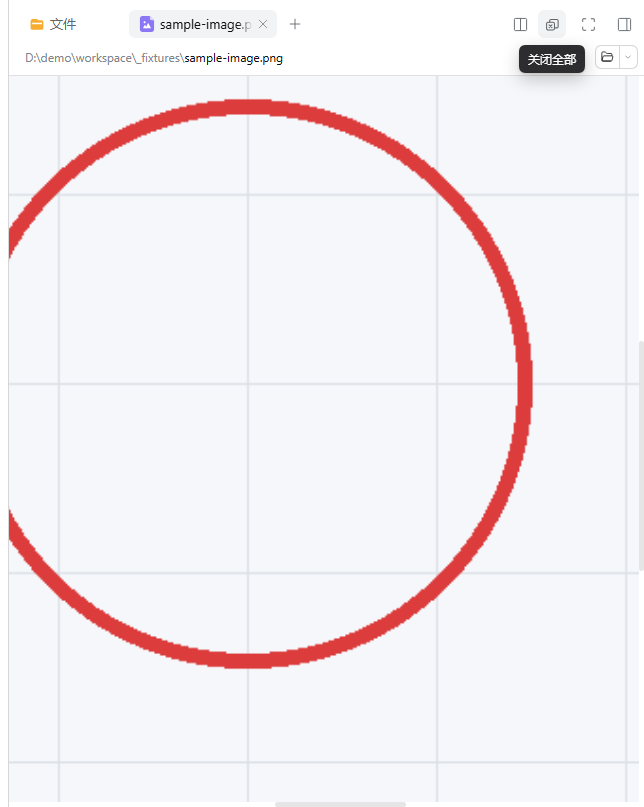
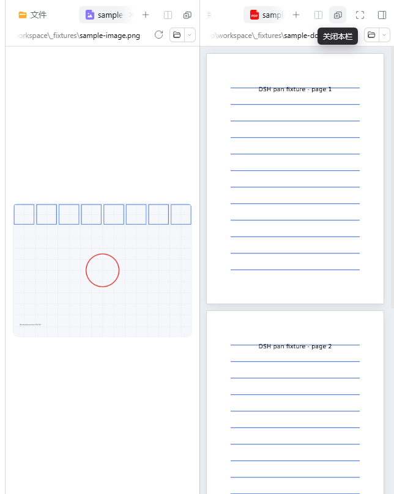
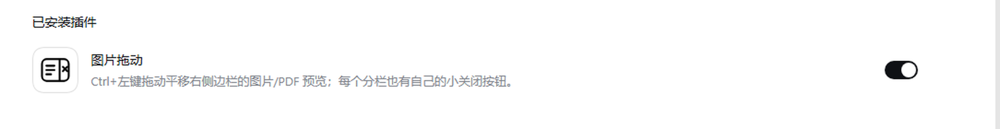

# Image Drag

English | [中文](README.md)

> Development: **AI-assisted programming**; see "AI-assisted development" at the end.

A small add-on for the DeepSeek Harness (DSH) right sidebar, focused on **image dragging** without taking over the native UI:

- **Ctrl + left-button drag (main feature)**: pan zoomed image / PDF previews (including Word/PPT converted to PDF).
- **One close button per pane**: with a split sidebar each pane gets its own button; a click clears only that pane and leaves it on its Start page.

| View | Effect |
| --- | --- |
| Single pane |  |
| Split panes |  |

Shown as **Image Drag** in *Plugins → Installed plugins*:



## Features

### 1. Ctrl + left-drag panning

Open an image, a PDF or an Office document (converted to PDF) in the right sidebar, zoom in with `Ctrl + wheel` or the zoom controls until scrollbars appear, then **hold Ctrl and drag with the left mouse button** to pan.

- Panning drives the preview's own scroll position (`scrollLeft` / `scrollTop`), so it composes with fit-width, fixed 25%–400% zoom and Ctrl+wheel zoom. It never replaces the image Blob URL and leaves the PDF vector/text layers intact.
- The cursor becomes a grab hand while Ctrl is held and a grabbing hand while dragging.
- A plain left drag keeps the native behaviour (PDF text selection is untouched). After a real pan, the trailing click that lands on the preview is swallowed so a PDF link cannot fire by accident; clicks elsewhere are unaffected.

### 2. One close button per pane

Every docked right-sidebar pane gets a close control in its tab strip:

- **Single pane**: tooltip "close all" — clears the pane's content, leaves the Start page, keeps the sidebar open.
- **Split panes**: one on each side, tooltip "close this pane" — clears only that pane; the other pane, the split layout and the sidebar stay as they are.
- If the pane has no Start tab yet, one is opened automatically before its content closes; once both panes are cleared you get two Start pages and further clicks are no-ops.
- The control reuses the native icon-button size and style, with a tooltip after ~0.4 s of hover.

## Install

Requires DeepSeek Harness `>= 0.2.0-rc.2` (verified on `0.2.1-rc.2`) with the `dsh` CLI.

### Option A: install from GitHub

```powershell
dsh plugin --profile desktop add "github:YuyuYuu-wyt/dsh-image-drag"
```

### Option B: clone and link

```powershell
git clone https://github.com/YuyuYuu-wyt/dsh-image-drag.git
cd dsh-image-drag
dsh plugin --profile desktop add "link:$PWD"
```

Or use the bundled script:

```powershell
powershell -NoProfile -ExecutionPolicy Bypass -File .\install.ps1 -Profile desktop
```

Refresh the DSH page (`Ctrl+R`) after installing; if the plugin still does not appear, fully quit and reopen DeepSeek Harness.

Uninstall:

```powershell
dsh plugin --profile desktop remove dsh-right-sidebar-toolkit
```

## How it works

A browser-side-only DSH plugin. No shipped package is modified and there is no host-side behaviour:

- `lib/client.js` loads as a `window.__ModuleLoader__` bundle. Panning attaches to the native preview's existing `[data-document-zoom-scrollport]`. The close control is injected into every pane's tab strip and uses the public `ctx.sidebarRight` controller: it guarantees a Start tab inside that pane first, then closes the remaining tabs — so the native "closing the last tab collapses the column" rule never fires.
- `lib/index.js` is an empty host half (it only exists so the bundle scan sees `dsh.client`).
- `locale/` + `icon.svg` provide the display name, description and icon in the plugin list.
- No network requests, no extra permissions, no persisted state.

## Known limits

- HTML previews run in a sandboxed iframe without the shared zoom viewport and are not pannable; text / code / Markdown previews are left untouched to keep text selection natural.
- Touch and trackpad scrolling keep the native system gestures; only the mouse `Ctrl + left-drag` gesture is added.
- With the sidebar fully collapsed and only floating windows left, the top buttons are not visible; expand the sidebar first.
- The close buttons act on docked panes; floating windows keep their native per-tab close controls.

## Verification

Independent acceptance (headless browser, real CDP mouse events driving a DSH web instance, with a no-plugin baseline profile): **15/15 criteria PASS**, covering per-pane closing in split mode, image/PDF panning, untouched native zoom, click-right-after-pan and a clean console. In the baseline, native Ctrl+drag pans nothing, confirming the behaviour comes from this plugin.

## AI-assisted development

The code in `lib/`, the documentation, the install script and the acceptance harness were produced with the help of an **AI coding assistant** (an AI agent running in DeepSeek Harness, i.e. AI-assisted programming). Requirements, design trade-offs, acceptance criteria and the release decision were made by the author.

The plugin is browser-side only: no host behaviour, no network requests and no persisted state. Review the code and its permission surface before use.

## License

[MIT](LICENSE)
